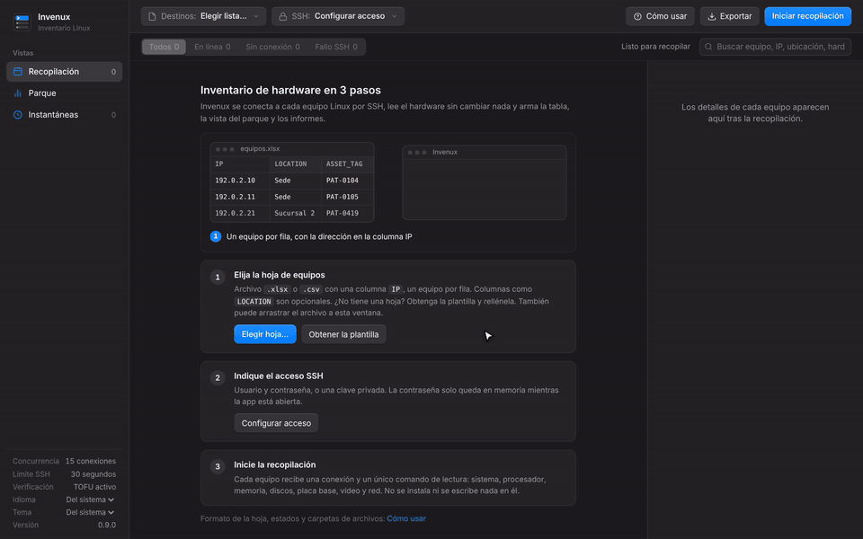
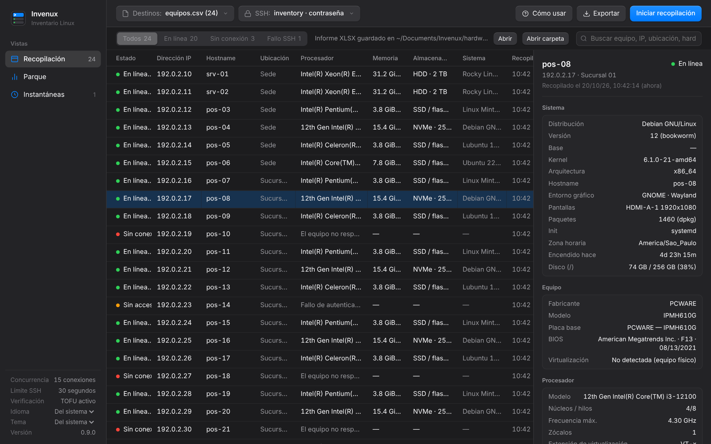
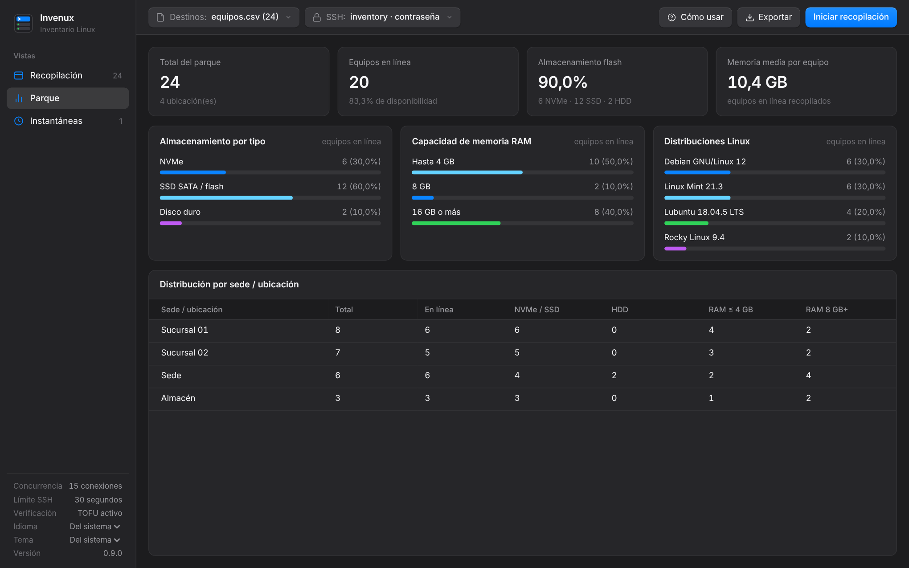
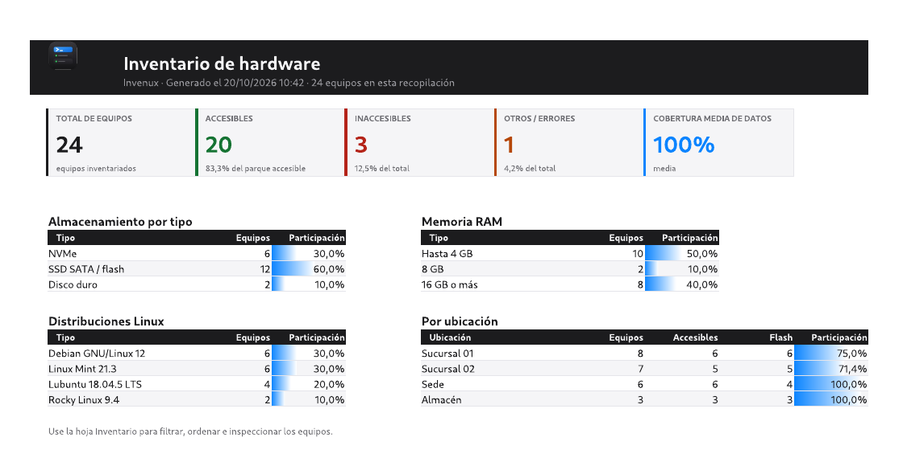
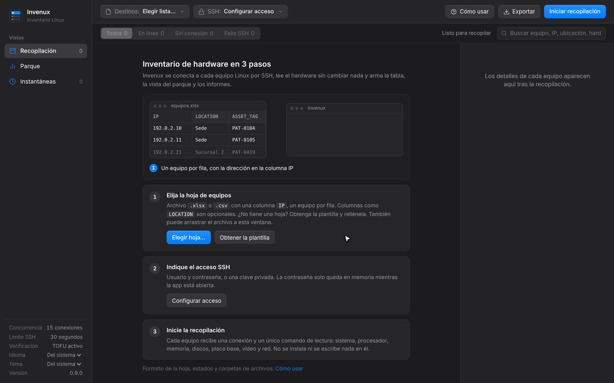
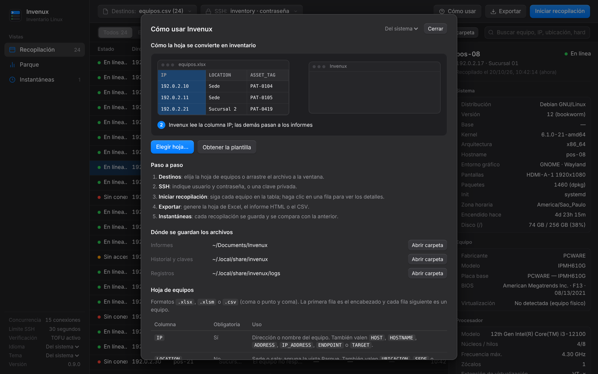
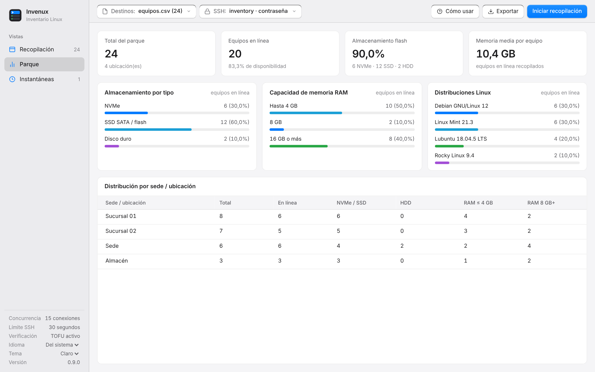
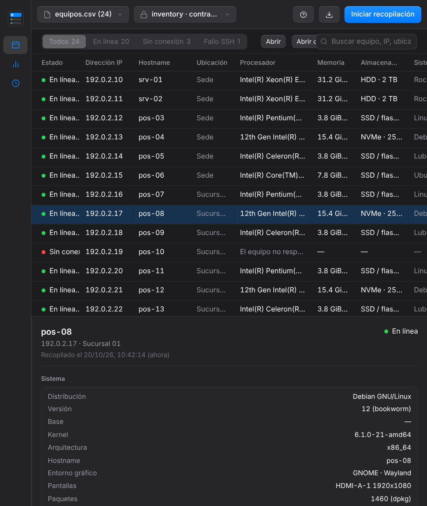

<div align="center">

<picture>
  <source media="(prefers-color-scheme: dark)" srcset="docs/media/wordmark-dark.png">
  
</picture>

<br>
<br>

**Inventario de hardware Linux por SSH, a partir de una hoja de equipos.**

Sin agente y de solo lectura: no se instala ni se escribe nada en los equipos.

<br>

<a href="https://github.com/lucaswotta/invenux/stargazers"></a>
<a href="https://github.com/lucaswotta/invenux/releases/latest"></a>
<a href="https://github.com/lucaswotta/invenux/actions/workflows/quality.yml"></a>
<a href="https://github.com/lucaswotta/invenux/commits/main"></a>
<a href="LICENSE"></a>


<a href="CONTRIBUTING.md"></a>

<br>

[Descargar](https://github.com/lucaswotta/invenux/releases/latest) ·
[Funciones](#funciones) ·
[Instalación](#instalación) ·
[Cómo usar](#cómo-usar) ·
[La hoja](#la-hoja) ·
[Preguntas](#preguntas-frecuentes) ·
[Contribuir](CONTRIBUTING.md) ·
[English](README.md) ·
[Português](README.pt-BR.md)

<br>



</div>

## Por qué Invenux

- **Entra una hoja, sale un inventario.** Liste los equipos con su IP, indique el acceso SSH e inicie. Cada equipo aparece con procesador, ranuras de memoria, discos, placa base, BIOS, vídeo, red y sistema operativo.
- **Nada que instalar en los equipos.** Una conexión SSH ejecuta un único script de lectura por equipo. Sin agente, sin servicio y sin archivos escritos en el destino.
- **Dice por qué falló un equipo.** Apagado, puerto SSH cerrado, tiempo agotado, nombre inexistente, contraseña incorrecta o clave del host cambiada, cada caso con su mensaje.
- **Informes que la gente abre.** Excel con hoja de resumen y columnas agrupadas, página HTML con búsqueda que funciona sin conexión, y CSV.
- **Historial sin servidor de base de datos.** Cada recopilación se guarda en el equipo local y se compara campo a campo con la anterior, así un disco cambiado o más memoria salta a la vista.

## Funciones

| Área | Qué obtiene |
| --- | --- |
| **Recopilación** | Hasta 128 conexiones SSH en paralelo en cualquier puerto SSH (22 por defecto), contraseña o clave privada, confianza en el primer acceso para claves de host, cancelación en cualquier momento. |
| **Sistema** | Distribución, versión y nombre en clave, kernel, arquitectura, hostname, entorno gráfico y servidor de vídeo, pantallas, cantidad de paquetes, init, zona horaria, tiempo encendido, uso del disco `/`. |
| **Hardware** | Fabricante y modelo, placa base, BIOS, procesador con núcleos, hilos y frecuencia, cada ranura de memoria (tamaño, tipo, velocidad, modelo del módulo) y el máximo de la placa, cada disco y partición, vídeo, adaptadores de red con IPv4 y MAC. |
| **Parque** | Tipos de almacenamiento, capacidad de memoria y distribuciones Linux de los equipos accesibles, y el desglose por ubicación. |
| **Instantáneas** | Historial local de cada recopilación con comparación campo a campo, exportable a CSV. |
| **Exportación** | Excel (resumen con barras de proporción, inventario agrupado por tema), HTML interactivo que funciona sin conexión, CSV protegido contra fórmulas. |
| **Interfaz** | Español, inglés y portugués, según el idioma del sistema; guía integrada con tutorial animado; redimensionable hasta 720 × 520. |
| **Escritorio** | Ventana nativa en Linux, Windows y macOS (pywebview o GTK), o el navegador; paquetes listos para los tres sistemas; tema claro y oscuro; la versión en la barra lateral y actualización con un clic cuando sale una versión nueva. |

<div align="center">



</div>

<table>
  <tr>
    <td width="50%"></td>
    <td width="50%"></td>
  </tr>
  <tr>
    <td align="center">Vista Parque</td>
    <td align="center">Exportación a Excel</td>
  </tr>
  <tr>
    <td width="50%"></td>
    <td width="50%"></td>
  </tr>
  <tr>
    <td align="center">Primer uso</td>
    <td align="center">Guía integrada</td>
  </tr>
  <tr>
    <td width="50%"></td>
    <td width="50%"></td>
  </tr>
  <tr>
    <td align="center">Tema claro</td>
    <td align="center">Ventana estrecha</td>
  </tr>
</table>

## Instalación

### Descargar

Descargue el archivo de su sistema en la [última versión](https://github.com/lucaswotta/invenux/releases/latest):

| Sistema | Archivo | Cómo abrirlo |
| --- | --- | --- |
| Windows 10/11 (x86_64) | `invenux-<versión>-windows-x86_64.exe` | Ejecútelo. SmartScreen avisa que el programa no está firmado: **Más información** y luego **Ejecutar de todos modos**. |
| macOS (Apple Silicon o Intel) | `invenux-<versión>-macos-arm64.zip` o `-macos-x86_64.zip` | Descomprima y abra `Invenux.app`. La primera vez, haga clic derecho y elija **Abrir**, porque la app no está notarizada. |
| Linux (x86_64, glibc 2.35 o posterior) | `invenux-<versión>-linux-x86_64.tar.xz` | Extraiga y ejecute `./install.sh` para agregarlo al menú de aplicaciones, o ejecute `./invenux` en la carpeta. |

Los paquetes no tienen firma de código; `SHA256SUMS` en la versión lista las sumas de verificación. Cada uno abre su propia ventana: WebView2 en Windows (incluido en Windows 10 y 11), WebKit en macOS y un Qt WebEngine incluido en Linux, por eso la descarga de Linux pesa unos 135 MB.

### Desde el código

**Requisitos:** Python 3.11 o posterior y equipos Linux accesibles por SSH (puerto 22 por defecto, configurable).

```sh
git clone https://github.com/lucaswotta/invenux.git
cd invenux
python3 -m venv .venv
source .venv/bin/activate          # Windows: .venv\Scripts\Activate.ps1
python3 -m pip install -r requirements.txt
python3 app.py
```

La ventana usa [pywebview](https://pywebview.flowrl.com/) si está instalado, luego GTK WebKit2 en Linux (`python3-gi` y `gir1.2-webkit2-4.1` en Debian y Ubuntu, visibles en un venv creado con `--system-site-packages`) y, si no hay ninguno, abre la interfaz en el navegador predeterminado. En el navegador, el programa se cierra unos 3 minutos después de cerrar la pestaña.

**Paquete nativo.** `python build.py` genera el paquete del sistema donde se ejecuta (PyInstaller no compila para otros sistemas): un `.exe` en Windows, una carpeta en Linux y una app en macOS. Una etiqueta `v*` hace que el CI genere los paquetes de Linux, Windows y macOS y los publique como release en GitHub.

```sh
python3 -m pip install -r requirements-build.txt
python3 build.py                   # dist/invenux-v0.9.0
```

En Linux, `./install.sh` en la carpeta extraída de la release copia el programa a `~/.local/lib/invenux`, crea el enlace `~/.local/bin/invenux` y agrega el acceso y el icono al menú, sin sudo. `./install.sh --uninstall` lo quita y conserva el historial y los informes.

## Cómo usar

1. **Destinos:** elija la hoja de equipos, arrastre el archivo a la ventana o pegue su ruta. ¿Aún no tiene una hoja? Use **Obtener la plantilla**.
2. **SSH:** indique el usuario, el puerto (22, salvo que sus equipos usen otro) y una contraseña o clave privada. La contraseña solo queda en memoria.
3. **Iniciar recopilación:** siga cada equipo en la tabla y haga clic en una fila para ver los detalles.
4. **Exportar:** Excel, HTML o CSV, guardados en la carpeta `Invenux` dentro de Documentos, con **Abrir** y **Abrir carpeta** a continuación.

El botón `Cómo usar` tiene el tutorial animado, el formato de la hoja, el significado de cada estado y botones para abrir las carpetas de informes, historial y registros.

**Línea de comandos.** Recopila y exporta sin interfaz (solo con clave privada):

```sh
python3 app.py --input equipos.xlsx --user inventario --key ~/.ssh/id_ed25519 --ssh-port 22 --output-format XLSX
```

## La hoja

`.xlsx`, `.xlsm` o `.csv` (coma o punto y coma). La primera fila es el encabezado y cada fila siguiente es un equipo.

| Columna | Obligatoria | Uso |
| --- | --- | --- |
| `IP` | Sí | Dirección o nombre del equipo. También valen `HOST`, `HOSTNAME`, `ADDRESS`, `IP_ADDRESS`, `ENDPOINT` o `TARGET`. |
| `LOCATION` | No | Sede o sala; agrupa el Parque y los informes. También valen `UBICACION`, `SEDE`, `SUCURSAL`, `SITE` o `LOCAL`. |
| `USER` | No | Usuario SSH de ese equipo cuando difiere del panel SSH. También valen `USERNAME`, `SSH_USER`, `LOGIN` o `USUARIO`. |
| `PASSWORD` | No | Contraseña SSH de ese equipo, para parques con contraseñas distintas; lo normal es dejarla en el panel SSH. También valen `PASS`, `SENHA` o `CONTRASENA`. Las celdas vacías usan el panel. Invenux solo la mantiene en memoria y nunca la escribe en la tabla, informes, instantáneas ni registros, pero el archivo la guarda en texto plano. |
| Cualquier otra | No | Se copia tal cual a la tabla y a todos los informes, por ejemplo `ASSET_TAG`, `OWNER` o `NOTES`. |

Las filas sin dirección y las direcciones repetidas se omiten y se listan al cargar. La plantilla (**Obtener la plantilla**) trae dos filas de ejemplo y una hoja que explica cada columna, en el idioma de la interfaz.

## Qué se recopila

Una conexión SSH por equipo ejecuta un único script de shell POSIX que lee:

| Fuente | Campos |
| --- | --- |
| `/etc/os-release`, `uname`, `/proc/1/comm`, `ps` | Distribución, versión, kernel, arquitectura, hostname, init, entorno gráfico y servidor de vídeo |
| `lscpu`, `/proc/cpuinfo` | Modelo de procesador, zócalos, núcleos, hilos, frecuencia máxima, extensión de virtualización |
| `/proc/meminfo`, `dmidecode -t memory` | Memoria total, en uso y disponible; cada ranura con tamaño, tipo, velocidad y modelo del módulo |
| `lsblk`, `df` | Cada disco y partición, tipo (NVMe, SSD o HDD), capacidad, uso de `/` |
| `/sys/class/dmi/id` | Fabricante, modelo, placa base, BIOS |
| `lspci`, `/sys/class/drm` | Tarjetas gráficas y pantallas conectadas |
| `/sys/class/net`, `ip` | Adaptadores de red, velocidad, driver, IPv4, MAC |
| `dpkg`, `rpm`, `pacman`, `apk`, `/etc/timezone` | Paquetes instalados, zona horaria |

Las ranuras de memoria requieren root (`dmidecode`); sin root, esos campos aparecen como no disponibles y el resto se recopila igual. El número de serie solo se recopila con `include_sensitive_identifiers` activado en el archivo de configuración.

## Dónde se guardan los archivos

| | Linux | Windows | macOS |
| --- | --- | --- | --- |
| Informes y plantilla | `~/Documentos/Invenux` (carpeta Documentos del sistema) | `Documents\Invenux` | `~/Documents/Invenux` |
| Historial (`snapshots.db`), claves de host (`known_hosts`), registros | `~/.local/share/invenux` | `%LOCALAPPDATA%\Invenux` | `~/Library/Application Support/Invenux` |
| Configuración (`config.json`) | `~/.config/invenux` | `%APPDATA%\Invenux` | `~/Library/Application Support/Invenux` |

Las carpetas del nombre anterior (`invent-ssh`) se copian en la primera ejecución.

## Seguridad y privacidad

- La interfaz solo escucha en `127.0.0.1`, con un token por ejecución y verificación del encabezado `Host` contra DNS rebinding.
- La contraseña SSH nunca se escribe en disco.
- Las claves de host usan confianza en el primer acceso por defecto: una clave nueva se guarda, una clave cambiada se rechaza. Desactívelo en el panel SSH para aceptar solo claves ya conocidas.
- Las exportaciones a hoja de cálculo neutralizan valores que empiezan como fórmula; el informe HTML escapa cada valor recopilado.
- Sin telemetría. Aparte del SSH a los equipos de su lista, el único acceso es la lectura de la última versión en la API de GitHub al abrir (`api.github.com/repos/lucaswotta/invenux/releases/latest`); se desactiva en la pantalla de ayuda. Las actualizaciones se verifican con el `SHA256SUMS` de la versión antes de abrirlas o instalarlas.

Las vulnerabilidades se reportan en privado, vea [SECURITY.md](SECURITY.md).

## Preguntas frecuentes

**¿Cambia algo en los equipos?**
No. El script solo lee archivos y ejecuta comandos de lectura. No escribe nada, ni siquiera en `/tmp`.

**¿Por qué todos mis equipos muestran un solo módulo de memoria?**
Mire la línea **Ranuras** en los detalles del equipo: muestra cuántas ranuras están ocupadas del total de la placa, con cada módulo listado. Si aparece no disponible, el usuario SSH no es root y `dmidecode` no pudo ejecutarse.

**Un equipo aparece Sin conexión, pero está encendido.**
La fila indica el motivo. "No respondió en la red" significa ninguna respuesta en unos 3 segundos (normalmente apagado o dirección incorrecta); "Conexión rechazada en el puerto N" significa que está encendido, pero el SSH está detenido, bloqueado o en otro puerto (ajústelo en el panel SSH); "Sin respuesta en N s" indica un cortafuegos o una red lenta, así que aumente el tiempo límite en el panel SSH.

**¿Hay instalador?**
Todavía no: Windows recibe un `.exe`, macOS una app y Linux una carpeta con `install.sh`. Vea [Descargar](#descargar).

**¿Puede inventariar equipos Windows o macOS?**
No. Los destinos deben ser Linux con SSH. El programa en sí funciona en Linux, Windows y macOS.

**¿Qué puerto usa?**
El 22 por defecto. Cámbielo en el panel SSH o con `--ssh-port` en la línea de comandos; todos los equipos de una recopilación usan el mismo puerto.

**¿Se puede usar sin la interfaz?**
Sí, vea la línea de comandos arriba. Requiere clave privada.

## Limitaciones

- Los destinos deben ser Linux con SSH, y todos los equipos de una recopilación comparten un puerto SSH.
- Los detalles de las ranuras de memoria requieren root en el destino.
- El tipo de almacenamiento usa el nombre del bus y el indicador de rotación del kernel, así que los discos virtuales pueden aparecer como SSD.
- La línea de comandos solo acepta clave privada, no contraseña.

## Próximos pasos

El trabajo previsto y los problemas conocidos están en las [issues](https://github.com/lucaswotta/invenux/issues): instaladores firmados, agente SSH y jump host, puerto SSH por equipo, recopilaciones programadas con informe de cambios, comparación entre dos instantáneas cualesquiera y accesibilidad. Los comentarios y pull requests en cualquiera de ellas son bienvenidos.

## Contribuir

Los pull requests son bienvenidos. [CONTRIBUTING.md](CONTRIBUTING.md) explica el entorno, las pruebas, cómo añadir un idioma y cómo se generan las capturas y los GIF de este README a partir de un parque ficticio (`scripts/demo_server.py`, `scripts/capture_media.mjs`).

Si Invenux le ahorra recorrer cada equipo, una estrella en el repositorio ayuda a que otras personas lo encuentren.

## Licencia

[MIT](LICENSE) © Lucas Motta
