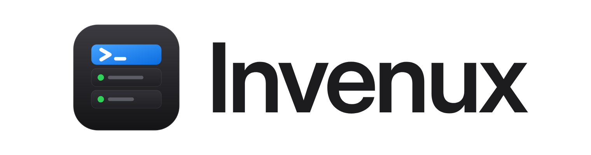
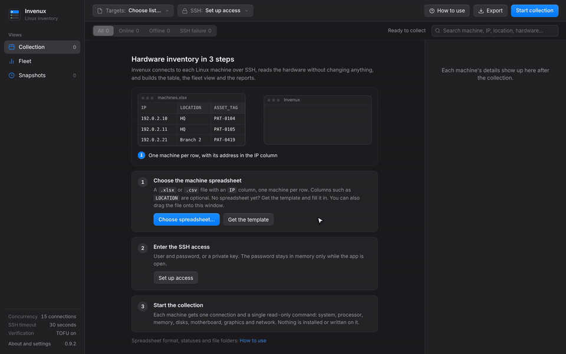
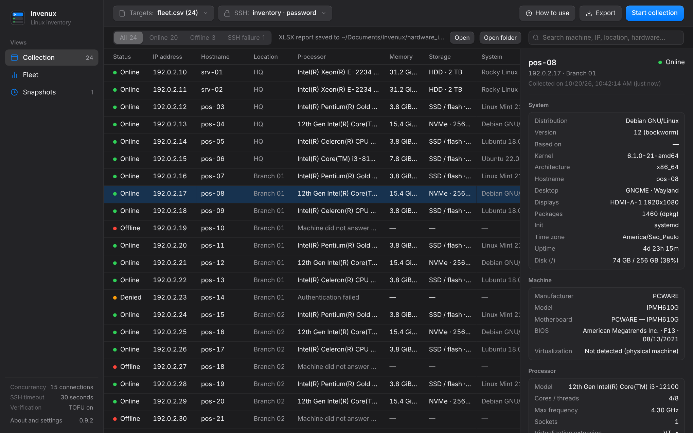
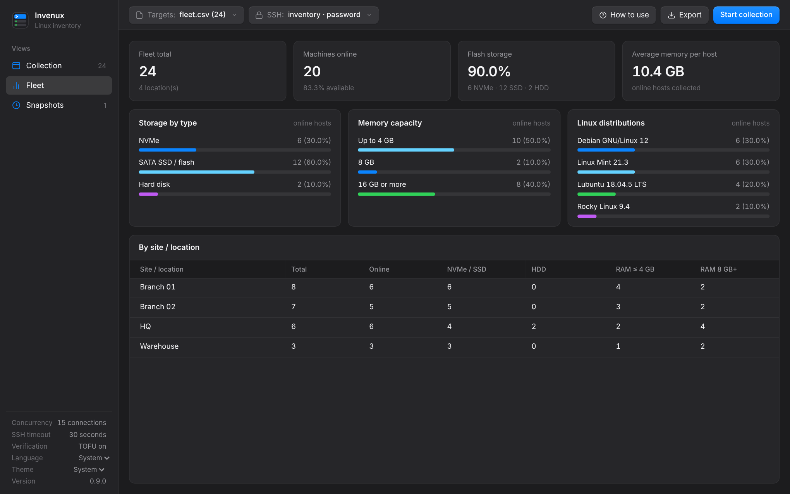
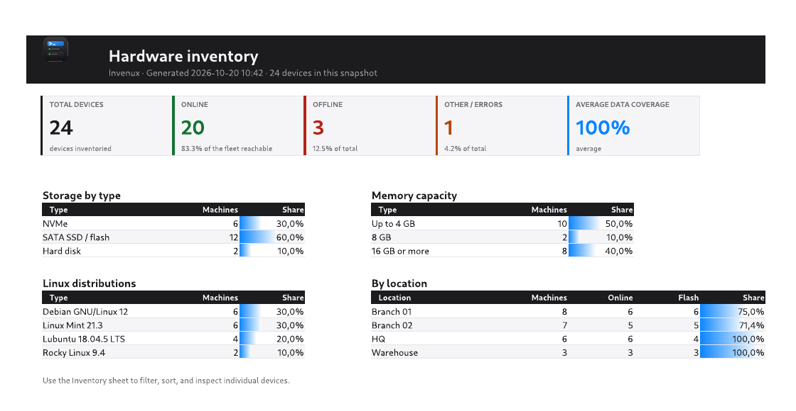
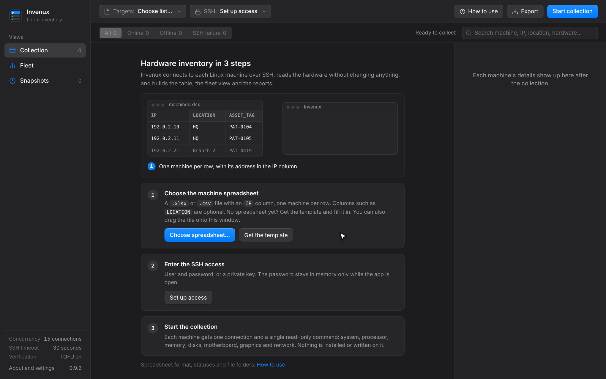
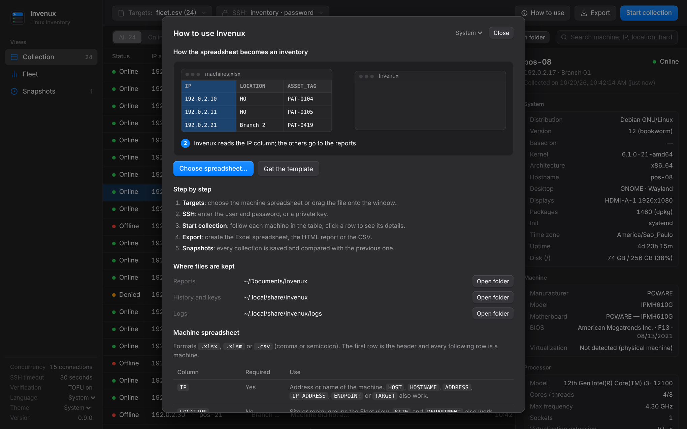
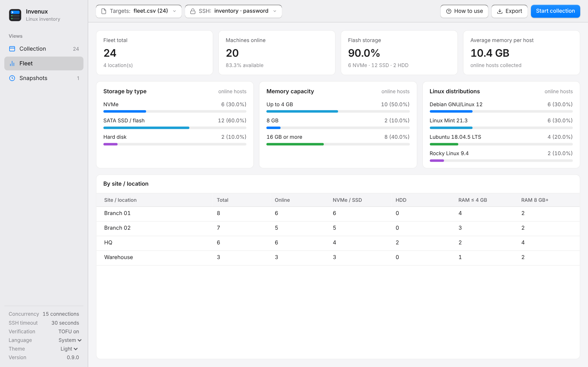
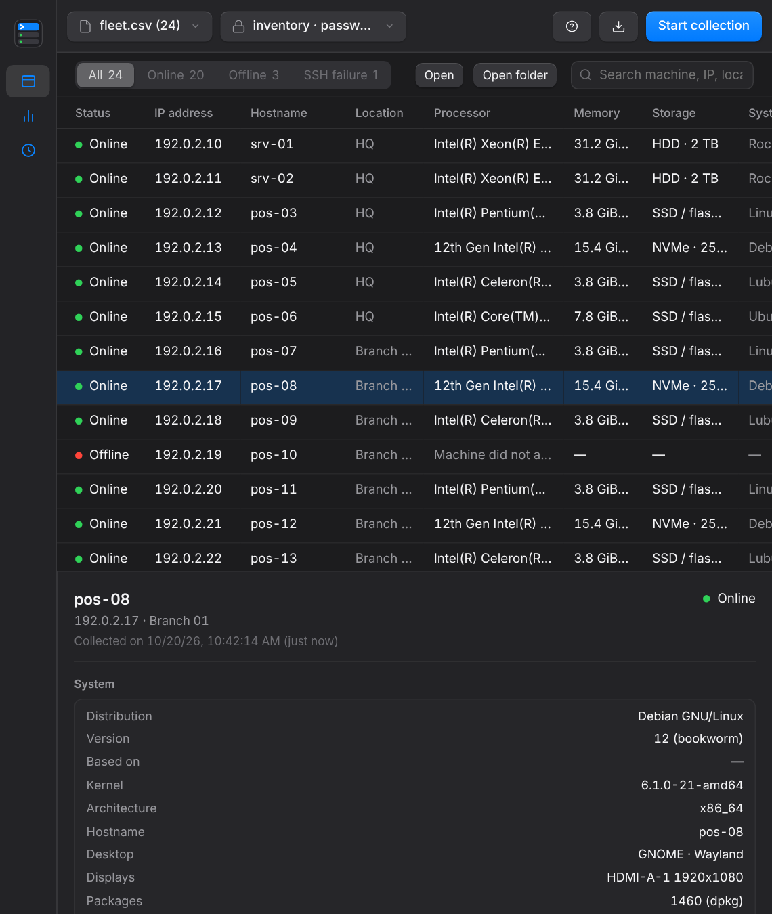

<div align="center">

<picture>
  <source media="(prefers-color-scheme: dark)" srcset="docs/media/wordmark-dark.png">
  
</picture>

<br>
<br>

**Linux hardware inventory over SSH, from a spreadsheet of machines.**

Agentless and read-only: nothing is installed or written on the machines.

<br>

<a href="https://github.com/lucaswotta/invenux/stargazers"></a>
<a href="https://github.com/lucaswotta/invenux/releases/latest"></a>
<a href="https://github.com/lucaswotta/invenux/actions/workflows/quality.yml"></a>
<a href="https://github.com/lucaswotta/invenux/commits/main"></a>
<a href="LICENSE"></a>


<a href="CONTRIBUTING.md"></a>

<br>

[Download](https://github.com/lucaswotta/invenux/releases/latest) ·
[Features](#features) ·
[Install](#install) ·
[How to use](#how-to-use) ·
[The spreadsheet](#the-spreadsheet) ·
[FAQ](#faq) ·
[Contribute](CONTRIBUTING.md) ·
[Português](README.pt-BR.md) ·
[Español](README.es.md)

<br>



</div>

## Why Invenux

- **One spreadsheet in, one inventory out.** List the machines with their IP addresses, enter SSH access, press start. Each machine shows up with processor, memory slots, disks, motherboard, BIOS, graphics, network and operating system.
- **Nothing to install on the machines.** One SSH connection runs one read-only script per machine. No agent, no daemon, no file written on the target.
- **It tells you why a machine failed.** Powered off, SSH port closed, time limit, unknown name, wrong password or a changed host key, each with its own message.
- **Reports people actually open.** Excel with a summary sheet and grouped columns, a searchable offline HTML page, and CSV.
- **History without a database server.** Every collection is saved locally and compared field by field with the previous one, so a swapped disk or a memory upgrade stands out.

## Features

| Area | What you get |
| --- | --- |
| **Collection** | Up to 128 parallel SSH connections on any SSH port (22 by default), password or private key, trust on first use for host keys, cancel at any time. |
| **System** | Distribution, version and codename, kernel, architecture, hostname, desktop and display server, displays, package count, init, time zone, uptime, root disk usage. |
| **Hardware** | Manufacturer and model, motherboard, BIOS, processor with cores, threads and frequency, every memory slot (size, type, speed, part number) and the board's maximum, every disk and partition, graphics, network adapters with IPv4 and MAC. |
| **Fleet view** | Storage types, memory capacity and Linux distributions across the online machines, and a breakdown by location. |
| **Snapshots** | Local history of every collection with a field-by-field comparison, exportable to CSV. |
| **Exports** | Excel (summary with data bars, inventory grouped by subject), interactive HTML that works offline, CSV with formula injection neutralized. |
| **Interface** | English, Portuguese (Brazil) and Spanish, following the system language; built-in guide with an animated tutorial; resizable down to 720 × 520. |
| **Desktop** | Native window on Linux, Windows and macOS (pywebview or GTK), or your browser; packaged builds for the three systems; light and dark themes; the version in the sidebar and a one-click update to a newer release. |

<div align="center">



</div>

<table>
  <tr>
    <td width="50%"></td>
    <td width="50%"></td>
  </tr>
  <tr>
    <td align="center">Fleet view</td>
    <td align="center">Excel export</td>
  </tr>
  <tr>
    <td width="50%"></td>
    <td width="50%"></td>
  </tr>
  <tr>
    <td align="center">First run</td>
    <td align="center">Built-in guide</td>
  </tr>
  <tr>
    <td width="50%"></td>
    <td width="50%"></td>
  </tr>
  <tr>
    <td align="center">Light theme</td>
    <td align="center">Narrow window</td>
  </tr>
</table>

## Install

### Download

Get the file for your system from the [latest release](https://github.com/lucaswotta/invenux/releases/latest):

| System | File | How to start |
| --- | --- | --- |
| Windows 10/11 (x86_64) | `invenux-<version>-windows-x86_64.exe` | Run it. SmartScreen warns about an unsigned program: **More info**, then **Run anyway**. |
| macOS (Apple Silicon or Intel) | `invenux-<version>-macos-arm64.zip` or `-macos-x86_64.zip` | Unzip and open `Invenux.app`. The first time, right-click it and choose **Open**, because the app is not notarized. |
| Linux (x86_64, glibc 2.35 or newer) | `invenux-<version>-linux-x86_64.tar.xz` | Extract and run `./install.sh` to add it to the application menu, or run `./invenux` from the folder. |

The packages are not code-signed; `SHA256SUMS` in the release lists the checksums. Each one opens its own window: WebView2 on Windows (part of Windows 10 and 11), WebKit on macOS and a bundled Qt WebEngine on Linux, which is why the Linux download is about 135 MB.

### From source

**Requirements:** Python 3.11 or newer, and Linux machines reachable over SSH (port 22 by default, configurable).

```sh
git clone https://github.com/lucaswotta/invenux.git
cd invenux
python3 -m venv .venv
source .venv/bin/activate          # Windows: .venv\Scripts\Activate.ps1
python3 -m pip install -r requirements.txt
python3 app.py
```

The window uses [pywebview](https://pywebview.flowrl.com/) when it is installed, then GTK WebKit2 on Linux (`python3-gi` and `gir1.2-webkit2-4.1` on Debian and Ubuntu, available to a venv created with `--system-site-packages`), and otherwise opens the interface in your default browser. In the browser the program stops about 3 minutes after the tab is closed.

**Native package.** `python build.py` creates the package for the system you run it on (PyInstaller is not a cross-compiler): one `.exe` on Windows, a folder on Linux and an app bundle on macOS. Pushing a `v*` tag builds the Linux, Windows and macOS packages in CI and publishes them as a GitHub release.

```sh
python3 -m pip install -r requirements-build.txt
python3 build.py                   # dist/invenux-v0.9.2
```

On Linux, `./install.sh` in the extracted release folder copies the program to `~/.local/lib/invenux`, links `~/.local/bin/invenux` and adds the menu entry and icon, without sudo. `./install.sh --uninstall` removes them and keeps history and reports.

## How to use

1. **Targets:** choose the machine spreadsheet, drag it onto the window, or paste its path. No spreadsheet yet? **Get the template**.
2. **SSH:** enter the user, the port (22 unless your machines use another one) and a password or a private key. The password stays in memory only.
3. **Start collection:** follow each machine in the table and click a row for its details.
4. **Export:** Excel, HTML or CSV, saved in the `Invenux` folder inside your Documents folder, with **Open** and **Open folder** right after.

`How to use` in the toolbar has the animated tutorial, the spreadsheet format, what each status means and buttons to open the report, history and log folders.

**Command line.** Collect and export without the interface (private key only):

```sh
python3 app.py --input machines.xlsx --user inventory --key ~/.ssh/id_ed25519 --ssh-port 22 --output-format XLSX
```

## The spreadsheet

`.xlsx`, `.xlsm` or `.csv` (comma or semicolon). The first row is the header and every following row is a machine.

| Column | Required | Use |
| --- | --- | --- |
| `IP` | Yes | Address or name of the machine. `HOST`, `HOSTNAME`, `ADDRESS`, `IP_ADDRESS`, `ENDPOINT` or `TARGET` also work. |
| `LOCATION` | No | Site or room; groups the fleet view and the reports. `SITE`, `LOCAL`, `UNIDADE`, `FILIAL`, `SETOR`, `UBICACION`, `SEDE` and `SUCURSAL` also work. |
| `USER` | No | SSH user for that machine when it differs from the SSH panel. `USERNAME`, `SSH_USER`, `LOGIN` and `USUARIO` also work. |
| `PASSWORD` | No | SSH password for that machine, for fleets where passwords differ; normally the password goes in the SSH panel. `PASS`, `SENHA` and `CONTRASENA` also work. Empty cells use the panel. Invenux keeps it in memory only and never writes it to the table, reports, snapshots or logs, but the file holds it as plain text. |
| Any other | No | Copied as is to the table and every report, for example `ASSET_TAG`, `OWNER` or `NOTES`. |

Rows without an address and repeated addresses are skipped and listed after loading. The template (**Get the template**) comes with two example rows and a sheet explaining each column, in the interface language.

## What is collected

One SSH connection per machine runs a single POSIX shell script that reads:

| Source | Fields |
| --- | --- |
| `/etc/os-release`, `uname`, `/proc/1/comm`, `ps` | Distribution, version, kernel, architecture, hostname, init, desktop and display server |
| `lscpu`, `/proc/cpuinfo` | Processor model, sockets, cores, threads, maximum frequency, virtualization extension |
| `/proc/meminfo`, `dmidecode -t memory` | Total, used and available memory; every slot with size, type, speed and part number |
| `lsblk`, `df` | Every disk and partition, type (NVMe, SSD or HDD), capacity, root usage |
| `/sys/class/dmi/id` | Manufacturer, model, motherboard, BIOS |
| `lspci`, `/sys/class/drm` | Graphics adapters and connected displays |
| `/sys/class/net`, `ip` | Network adapters, link speed, driver, IPv4, MAC |
| `dpkg`, `rpm`, `pacman`, `apk`, `/etc/timezone` | Installed packages, time zone |

Memory slots need root (`dmidecode`); without it the slot fields show as unavailable and everything else is still collected. The serial number is not collected unless `include_sensitive_identifiers` is enabled in the configuration file.

## Where files are kept

| | Linux | Windows | macOS |
| --- | --- | --- | --- |
| Reports and template | `~/Documents/Invenux` (localized, for example `~/Documentos/Invenux`) | `Documents\Invenux` | `~/Documents/Invenux` |
| History (`snapshots.db`), host keys (`known_hosts`), logs | `~/.local/share/invenux` | `%LOCALAPPDATA%\Invenux` | `~/Library/Application Support/Invenux` |
| Settings (`config.json`) | `~/.config/invenux` | `%APPDATA%\Invenux` | `~/Library/Application Support/Invenux` |

Folders from the old name (`invent-ssh`) are copied over on the first run.

## Security and privacy

- The interface is served on `127.0.0.1` only, with a per-run token and a check of the `Host` header against DNS rebinding.
- The SSH password is never written to disk.
- Host keys use trust on first use by default: a new key is stored, a changed key is rejected. Turn it off in the SSH panel to accept only keys already known.
- Spreadsheet exports neutralize values that start like a formula; the HTML report escapes every collected value.
- No telemetry. Besides SSH to the machines you list, the only request is a read of the latest release from the GitHub API on startup (`api.github.com/repos/lucaswotta/invenux/releases/latest`); turn it off in the help sheet. Updates are checked against the release's `SHA256SUMS` before they are opened or installed.

Report vulnerabilities privately, see [SECURITY.md](SECURITY.md).

## FAQ

**Does it change anything on the machines?**
No. The script only reads files and runs read-only commands. It writes nothing, not even to `/tmp`.

**Why do all my machines show a single memory module?**
Check the **Slots** line in the machine details: it shows how many slots are populated out of how many the board has, with each module listed. If it says unavailable, the SSH user is not root and `dmidecode` could not run.

**A machine shows as Offline, but it is on.**
The row says why. "Did not answer on the network" means no reply at all within about 3 seconds (often powered off or a wrong address); "Connection refused on port N" means it is on but SSH is stopped, blocked or listening on another port (set it in the SSH panel); "No answer within N s" means a firewall or a slow link, so raise the timeout in the SSH panel.

**Is there an installer?**
Not yet: Windows gets one `.exe`, macOS an app bundle and Linux a folder with `install.sh`. See [Download](#download).

**Can it inventory Windows or macOS machines?**
No. The targets must be Linux with SSH. The program itself runs on Linux, Windows and macOS.

**Which port does it use?**
22 by default. Change it in the SSH panel, or with `--ssh-port` on the command line; every machine in a collection uses the same port.

**Can I run it without the interface?**
Yes, see the command line above. It needs a private key.

## Limitations

- Targets must be Linux with SSH, and all machines in a collection share one SSH port.
- Memory slot details need root on the target.
- Storage type uses the transport name and the kernel's rotational flag, so virtual disks can appear as SSD.
- The command line accepts a private key only, not a password.

## Roadmap

Planned work and known problems are tracked as [issues](https://github.com/lucaswotta/invenux/issues): signed installers, SSH agent and jump host, per-machine SSH port, scheduled collections with a change report, comparing any two snapshots and accessibility. Comments and pull requests on any of them are welcome.

## Contributing

Pull requests are welcome. [CONTRIBUTING.md](CONTRIBUTING.md) covers setup, tests, how to add a language and how the screenshots and GIFs in this README are regenerated from a fictional fleet (`scripts/demo_server.py`, `scripts/capture_media.mjs`).

If Invenux saves you a walk to every machine, starring the repository helps other people find it.

## License

[MIT](LICENSE) © Lucas Motta
