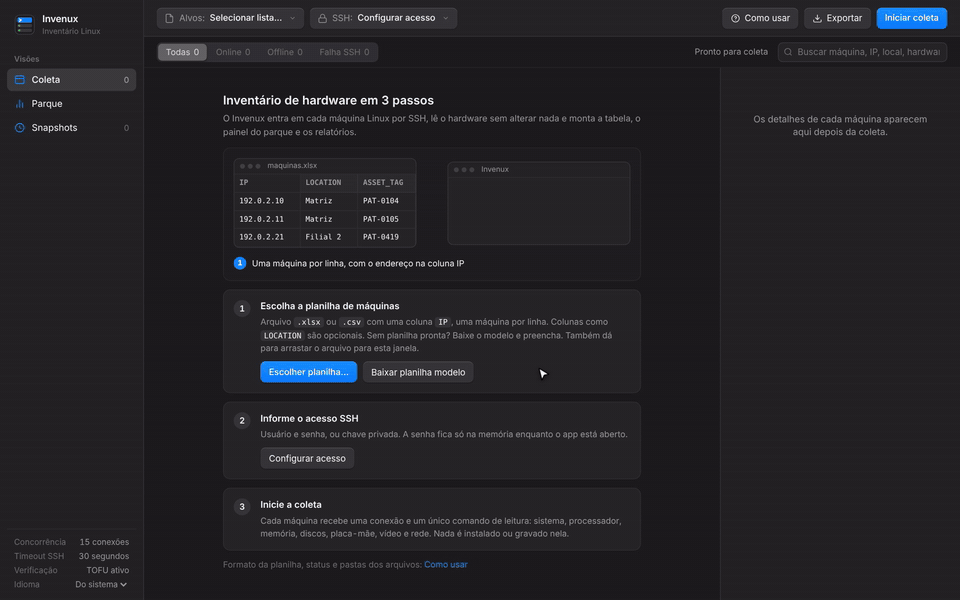
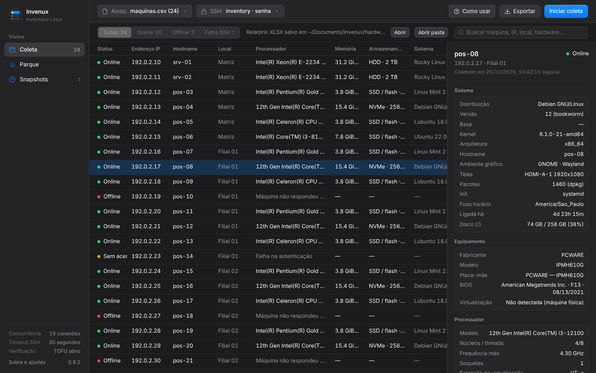
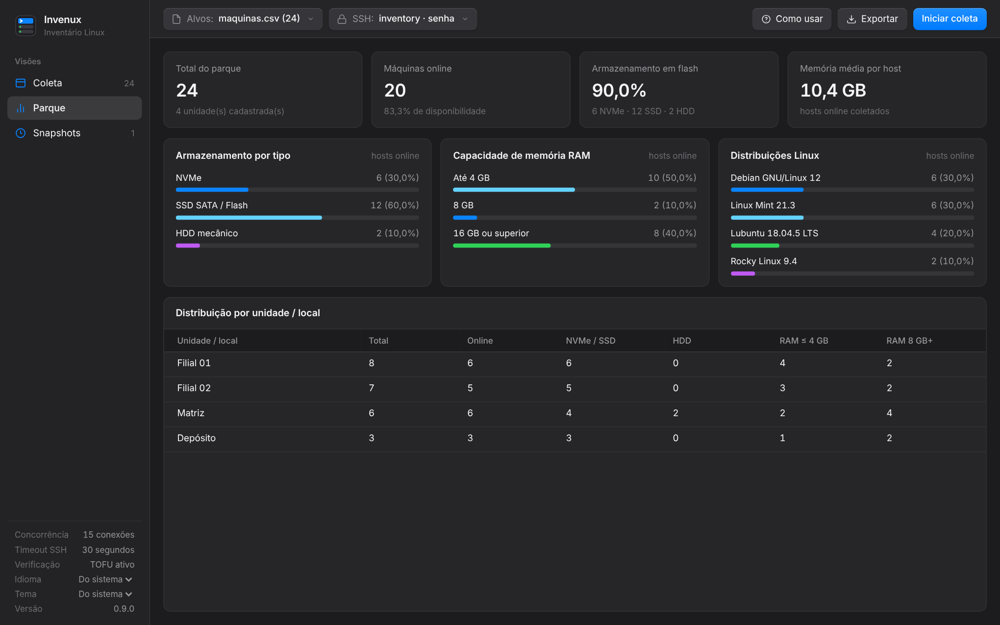
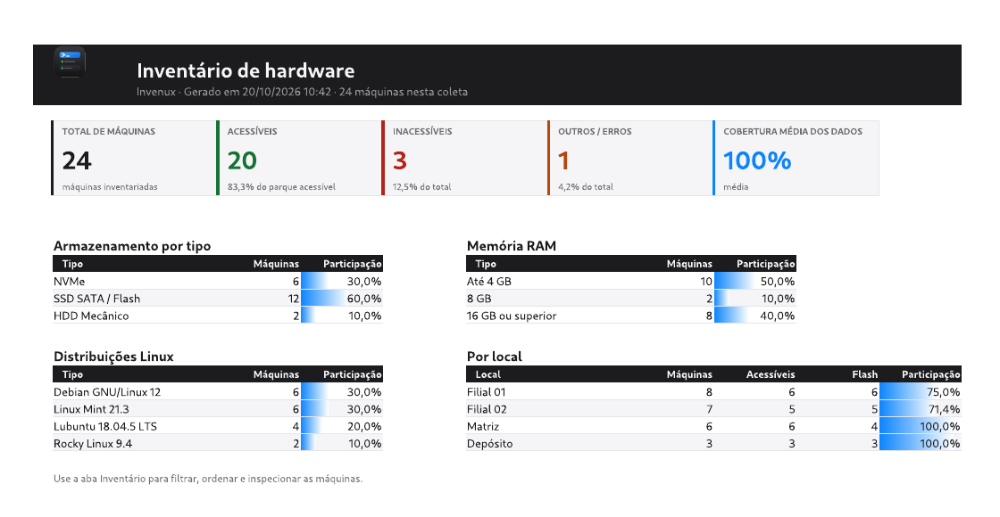
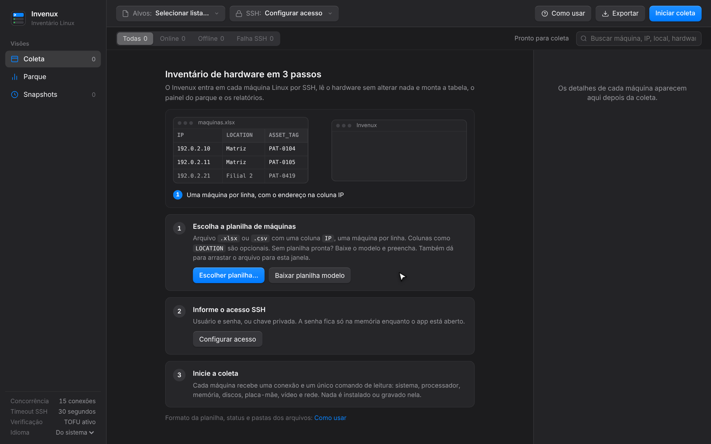
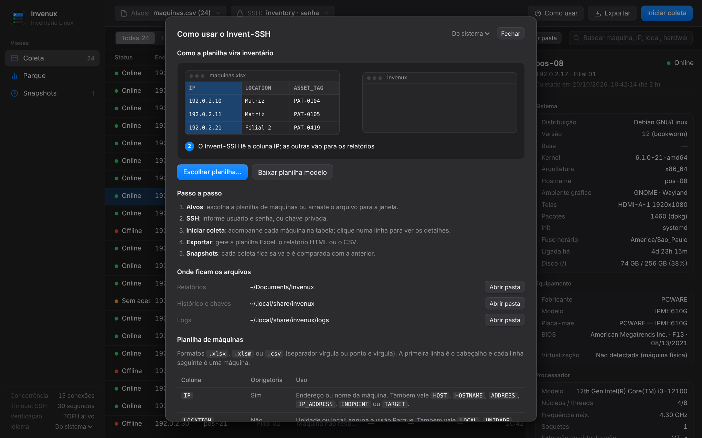

<div align="center">

<picture>
  <source media="(prefers-color-scheme: dark)" srcset="docs/media/wordmark-dark.png">
  
</picture>

<br>
<br>

**Inventário de hardware Linux via SSH, a partir de uma planilha de máquinas.**

Sem agente e só leitura: nada é instalado ou gravado nas máquinas.

<br>

<a href="https://github.com/lucaswotta/invenux/stargazers"></a>
<a href="https://github.com/lucaswotta/invenux/releases/latest"></a>
<a href="https://github.com/lucaswotta/invenux/actions/workflows/quality.yml"></a>
<a href="https://github.com/lucaswotta/invenux/commits/main"></a>
<a href="LICENSE"></a>


<a href="CONTRIBUTING.md"></a>

<br>

[Baixar](https://github.com/lucaswotta/invenux/releases/latest) ·
[Recursos](#recursos) ·
[Instalação](#instalação) ·
[Como usar](#como-usar) ·
[A planilha](#a-planilha) ·
[Perguntas](#perguntas-frequentes) ·
[Contribuir](CONTRIBUTING.md) ·
[English](README.md) ·
[Español](README.es.md)

<br>



</div>

## Por que o Invenux

- **Entra uma planilha, sai um inventário.** Liste as máquinas com o IP, informe o acesso SSH e inicie. Cada máquina aparece com processador, slots de memória, discos, placa-mãe, BIOS, vídeo, rede e sistema operacional.
- **Nada para instalar nas máquinas.** Uma conexão SSH executa um único script de leitura por máquina. Sem agente, sem serviço e sem arquivo gravado no destino.
- **Diz por que uma máquina falhou.** Desligada, porta SSH fechada, tempo esgotado, nome inexistente, senha errada ou chave do host trocada, cada caso com sua mensagem.
- **Relatórios que as pessoas abrem.** Excel com aba de resumo e colunas agrupadas, página HTML pesquisável que funciona offline, e CSV.
- **Histórico sem servidor de banco.** Cada coleta fica salva no computador e é comparada campo a campo com a anterior, então um disco trocado ou uma memória a mais aparece na hora.

## Recursos

| Área | O que você tem |
| --- | --- |
| **Coleta** | Até 128 conexões SSH em paralelo em qualquer porta SSH (22 por padrão), senha ou chave privada, confiança no primeiro acesso para chaves de host, cancelamento a qualquer momento. |
| **Sistema** | Distribuição, versão e codinome, kernel, arquitetura, hostname, ambiente gráfico e servidor de vídeo, telas, quantidade de pacotes, init, fuso horário, tempo ligado, uso do disco `/`. |
| **Hardware** | Fabricante e modelo, placa-mãe, BIOS, processador com núcleos, threads e frequência, cada slot de memória (tamanho, tipo, velocidade, modelo do pente) e o máximo da placa, cada disco e partição, vídeo, adaptadores de rede com IPv4 e MAC. |
| **Parque** | Tipos de armazenamento, capacidade de memória e distribuições Linux das máquinas acessíveis, e a divisão por local. |
| **Snapshots** | Histórico local de cada coleta com comparação campo a campo, exportável em CSV. |
| **Exportação** | Excel (resumo com barras de proporção, inventário agrupado por assunto), HTML interativo que funciona offline, CSV com proteção contra fórmulas. |
| **Interface** | Português, inglês e espanhol, seguindo o idioma do sistema; guia embutido com tutorial animado; redimensionável até 720 × 520. |
| **Desktop** | Janela nativa no Linux, Windows e macOS (pywebview ou GTK), ou o navegador; pacotes prontos para os três sistemas. |

<div align="center">



</div>

<table>
  <tr>
    <td width="50%"></td>
    <td width="50%"></td>
  </tr>
  <tr>
    <td align="center">Visão Parque</td>
    <td align="center">Exportação para Excel</td>
  </tr>
  <tr>
    <td width="50%"></td>
    <td width="50%"></td>
  </tr>
  <tr>
    <td align="center">Primeiro uso</td>
    <td align="center">Guia embutido</td>
  </tr>
</table>

## Instalação

### Baixar

Baixe o arquivo do seu sistema na [última versão](https://github.com/lucaswotta/invenux/releases/latest):

| Sistema | Arquivo | Como abrir |
| --- | --- | --- |
| Windows 10/11 (x86_64) | `invenux-<versão>-windows-x86_64.exe` | Execute. O SmartScreen avisa que o programa não é assinado: **Mais informações** e depois **Executar assim mesmo**. |
| macOS (Apple Silicon ou Intel) | `invenux-<versão>-macos-arm64.zip` ou `-macos-x86_64.zip` | Descompacte e abra o `Invenux.app`. Na primeira vez, clique com o botão direito e escolha **Abrir**, porque o app não é notarizado. |
| Linux (x86_64, glibc 2.35 ou mais recente) | `invenux-<versão>-linux-x86_64.tar.xz` | Extraia e rode `./install.sh` para colocar no menu de aplicativos, ou rode `./invenux` na pasta. |

Os pacotes não têm assinatura de código; o `SHA256SUMS` da versão lista os checksums. Cada um abre a própria janela: WebView2 no Windows (parte do Windows 10 e 11), WebKit no macOS e um Qt WebEngine embutido no Linux, por isso o download do Linux tem cerca de 135 MB.

### A partir do código

**Requisitos:** Python 3.11 ou mais recente e máquinas Linux acessíveis por SSH (porta 22 por padrão, configurável).

```sh
git clone https://github.com/lucaswotta/invenux.git
cd invenux
python3 -m venv .venv
source .venv/bin/activate          # Windows: .venv\Scripts\Activate.ps1
python3 -m pip install -r requirements.txt
python3 app.py
```

A janela usa o [pywebview](https://pywebview.flowrl.com/) quando ele está instalado, depois o GTK WebKit2 no Linux (`python3-gi` e `gir1.2-webkit2-4.1` no Debian e Ubuntu, visíveis num venv criado com `--system-site-packages`) e, sem nenhum dos dois, abre a interface no navegador padrão. No navegador, o programa encerra cerca de 3 minutos depois que a aba é fechada.

**Pacote nativo.** `python build.py` gera o pacote do sistema em que roda (o PyInstaller não faz compilação cruzada): um `.exe` no Windows, uma pasta no Linux e um app no macOS. Uma tag `v*` faz o CI gerar os pacotes de Linux, Windows e macOS e publicá-los como release no GitHub.

```sh
python3 -m pip install -r requirements-build.txt
python3 build.py                   # dist/invenux-v0.8.0
```

No Linux, `./install.sh` na pasta extraída da release copia o programa para `~/.local/lib/invenux`, cria o link `~/.local/bin/invenux` e adiciona o atalho e o ícone no menu, sem sudo. `./install.sh --uninstall` remove tudo e mantém histórico e relatórios.

## Como usar

1. **Alvos:** escolha a planilha de máquinas, arraste o arquivo para a janela ou cole o caminho. Ainda não tem planilha? Use **Baixar planilha modelo**.
2. **SSH:** informe o usuário, a porta (22, a menos que suas máquinas usem outra) e uma senha ou chave privada. A senha fica só na memória.
3. **Iniciar coleta:** acompanhe cada máquina na tabela e clique numa linha para ver os detalhes.
4. **Exportar:** Excel, HTML ou CSV, salvos na pasta `Invenux` dentro de Documentos, com **Abrir** e **Abrir pasta** logo em seguida.

O botão `Como usar` tem o tutorial animado, o formato da planilha, o significado de cada status e botões para abrir as pastas de relatórios, histórico e logs.

**Linha de comando.** Coleta e exporta sem interface (só com chave privada):

```sh
python3 app.py --input maquinas.xlsx --user inventario --key ~/.ssh/id_ed25519 --ssh-port 22 --output-format XLSX
```

## A planilha

`.xlsx`, `.xlsm` ou `.csv` (vírgula ou ponto e vírgula). A primeira linha é o cabeçalho e cada linha seguinte é uma máquina.

| Coluna | Obrigatória | Uso |
| --- | --- | --- |
| `IP` | Sim | Endereço ou nome da máquina. Também vale `HOST`, `HOSTNAME`, `ADDRESS`, `IP_ADDRESS`, `ENDPOINT` ou `TARGET`. |
| `LOCATION` | Não | Unidade ou sala; agrupa o Parque e os relatórios. Também vale `LOCAL`, `UNIDADE`, `FILIAL`, `SETOR`, `SITE`, `UBICACION`, `SEDE` ou `SUCURSAL`. |
| `USER` | Não | Usuário SSH daquela máquina, quando difere do painel SSH. Também vale `USERNAME`, `SSH_USER`, `LOGIN` ou `USUARIO`. |
| `PASSWORD` | Não | Senha SSH daquela máquina, para parques com senhas diferentes; o normal é deixar a senha no painel SSH. Também vale `PASS`, `SENHA` ou `CONTRASENA`. Células vazias usam o painel. O Invenux a mantém só na memória e nunca a grava na tabela, relatórios, snapshots ou logs, mas o arquivo a guarda em texto puro. |
| Qualquer outra | Não | Copiada como está para a tabela e para todos os relatórios, por exemplo `ASSET_TAG`, `OWNER` ou `NOTES`. |

Linhas sem IP e IPs repetidos são ignorados e listados depois de carregar. A planilha modelo (**Baixar planilha modelo**) vem com duas linhas de exemplo e uma aba explicando cada coluna, no idioma da interface.

## O que é coletado

Uma conexão SSH por máquina executa um único script de shell POSIX que lê:

| Fonte | Campos |
| --- | --- |
| `/etc/os-release`, `uname`, `/proc/1/comm`, `ps` | Distribuição, versão, kernel, arquitetura, hostname, init, ambiente gráfico e servidor de vídeo |
| `lscpu`, `/proc/cpuinfo` | Modelo do processador, soquetes, núcleos, threads, frequência máxima, extensão de virtualização |
| `/proc/meminfo`, `dmidecode -t memory` | Memória total, em uso e disponível; cada slot com tamanho, tipo, velocidade e modelo do pente |
| `lsblk`, `df` | Cada disco e partição, tipo (NVMe, SSD ou HDD), capacidade, uso do `/` |
| `/sys/class/dmi/id` | Fabricante, modelo, placa-mãe, BIOS |
| `lspci`, `/sys/class/drm` | Placas de vídeo e telas conectadas |
| `/sys/class/net`, `ip` | Adaptadores de rede, velocidade, driver, IPv4, MAC |
| `dpkg`, `rpm`, `pacman`, `apk`, `/etc/timezone` | Pacotes instalados, fuso horário |

Os slots de memória exigem root (`dmidecode`); sem root, esses campos aparecem como indisponíveis e o resto é coletado normalmente. O número de série só é coletado com `include_sensitive_identifiers` ativado no arquivo de configuração.

## Onde ficam os arquivos

| | Linux | Windows | macOS |
| --- | --- | --- | --- |
| Relatórios e planilha modelo | `~/Documentos/Invenux` (pasta Documentos do sistema) | `Documents\Invenux` | `~/Documents/Invenux` |
| Histórico (`snapshots.db`), chaves de host (`known_hosts`), logs | `~/.local/share/invenux` | `%LOCALAPPDATA%\Invenux` | `~/Library/Application Support/Invenux` |
| Configuração (`config.json`) | `~/.config/invenux` | `%APPDATA%\Invenux` | `~/Library/Application Support/Invenux` |

As pastas do nome antigo (`invent-ssh`) são copiadas na primeira execução.

## Segurança e privacidade

- A interface só escuta em `127.0.0.1`, com um token por execução e verificação do cabeçalho `Host` contra DNS rebinding.
- A senha SSH nunca é gravada em disco.
- As chaves de host usam confiança no primeiro acesso por padrão: chave nova é guardada, chave trocada é recusada. Desligue no painel SSH para aceitar só chaves já conhecidas.
- As exportações em planilha neutralizam valores que começam como fórmula; o relatório HTML escapa cada valor coletado.
- Sem telemetria e sem acesso à rede além do SSH para as máquinas da sua lista.

Vulnerabilidades devem ser reportadas em privado, veja [SECURITY.md](SECURITY.md).

## Perguntas frequentes

**Ele altera alguma coisa nas máquinas?**
Não. O script só lê arquivos e executa comandos de leitura. Nada é gravado, nem em `/tmp`.

**Por que todas as minhas máquinas mostram um único pente de memória?**
Veja a linha **Slots** nos detalhes da máquina: ela mostra quantos slots estão ocupados do total da placa, com cada pente listado. Se aparecer indisponível, o usuário SSH não é root e o `dmidecode` não rodou.

**Uma máquina aparece Offline, mas está ligada.**
A linha diz o motivo. "Não respondeu na rede" significa nenhuma resposta em cerca de 3 segundos (em geral desligada ou endereço errado); "Conexão recusada na porta N" significa que está ligada, mas o SSH está parado, bloqueado ou em outra porta (ajuste no painel SSH); "Sem resposta em N s" indica firewall ou rede lenta, então aumente o timeout no painel SSH.

**Tem instalador?**
Ainda não: o Windows recebe um `.exe`, o macOS um app e o Linux uma pasta com `install.sh`. Veja [Baixar](#baixar).

**Dá para inventariar máquinas Windows ou macOS?**
Não. Os alvos precisam ser Linux com SSH. O programa em si roda em Linux, Windows e macOS.

**Qual porta ele usa?**
A 22 por padrão. Troque no painel SSH ou com `--ssh-port` na linha de comando; todas as máquinas de uma coleta usam a mesma porta.

**Dá para rodar sem a interface?**
Sim, veja a linha de comando acima. Ela exige chave privada.

## Limitações

- Os alvos precisam ser Linux com SSH, e todas as máquinas de uma coleta usam a mesma porta SSH.
- Os detalhes dos slots de memória exigem root no alvo.
- O tipo de armazenamento usa o nome do barramento e a flag de rotação do kernel, então discos virtuais podem aparecer como SSD.
- A linha de comando aceita só chave privada, não senha.

## Próximos passos

O trabalho planejado e os problemas conhecidos estão nas [issues](https://github.com/lucaswotta/invenux/issues): instaladores assinados, agente SSH e jump host, porta SSH por máquina, coletas agendadas com relatório de mudanças, comparação entre quaisquer dois snapshots, tema claro e acessibilidade. Comentários e pull requests em qualquer uma delas são bem-vindos.

## Contribuir

Pull requests são bem-vindos. O [CONTRIBUTING.md](CONTRIBUTING.md) explica o ambiente, os testes, como adicionar um idioma e como os prints e GIFs deste README são gerados a partir de um parque fictício (`scripts/demo_server.py`, `scripts/capture_media.mjs`).

Se o Invenux te poupa uma volta por todas as máquinas, uma estrela no repositório ajuda outras pessoas a encontrá-lo.

## Licença

[MIT](LICENSE) © Lucas Motta
